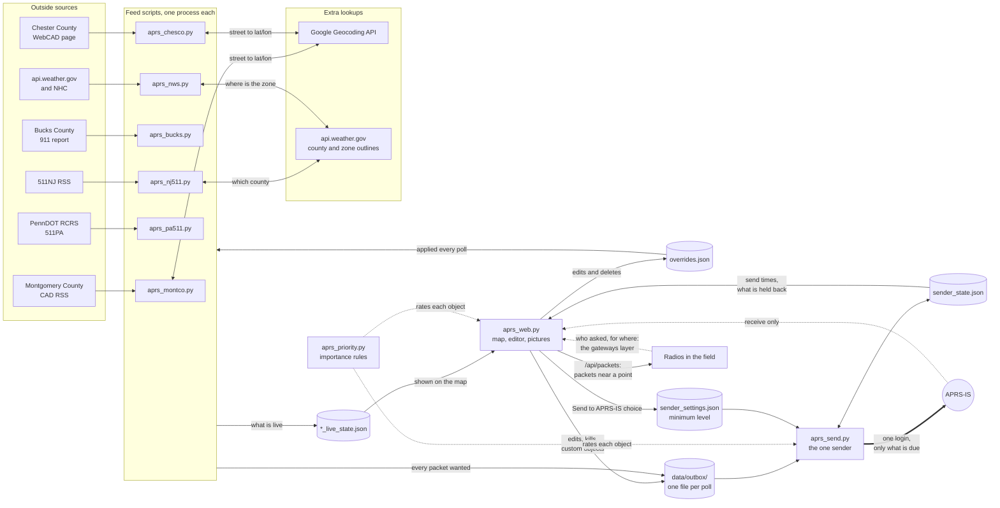
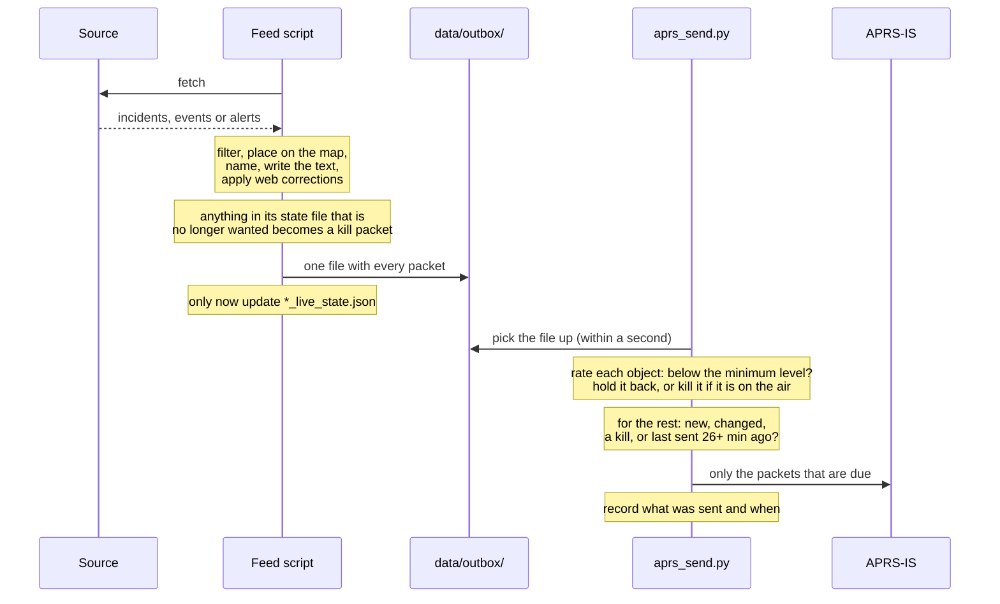
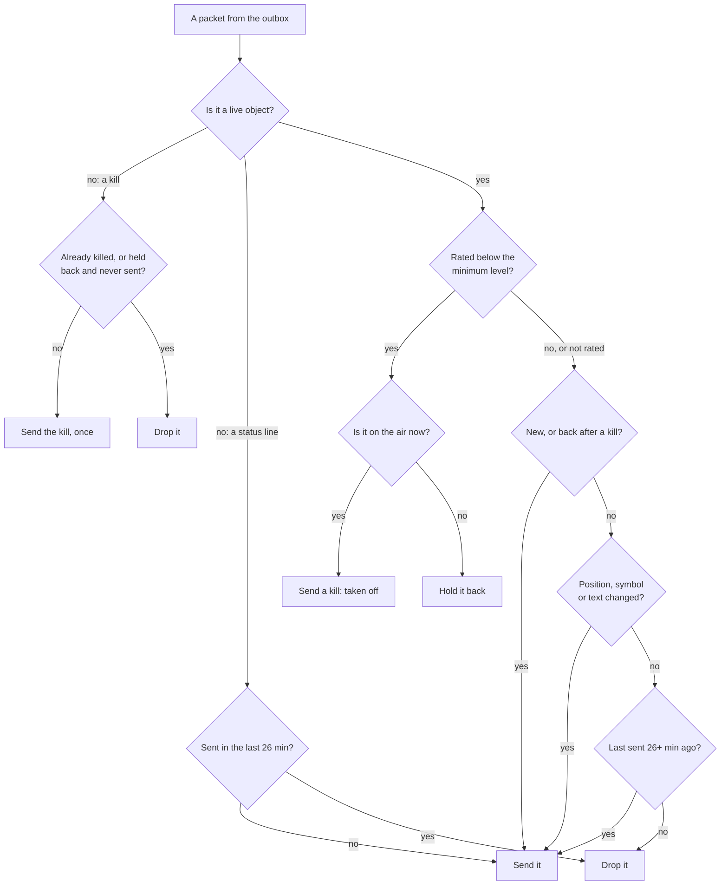

# How the aprs-incident-feeder stack works

This folder turns public dispatch, traffic and weather feeds into APRS objects on APRS-IS, sent
under one callsign. It runs on a Raspberry Pi as eight small programs, all Python 3 standard
library, started and watched by one shell script.

- Seven **feed scripts** each poll one source and work out which objects should be on the air.
- One **sender** (`aprs_send.py`) holds the only sending connection to APRS-IS and decides which
  packets actually go out.
- One **web service** (`aprs_web.py`) shows a map of the objects, lets you correct or delete them,
  lets you choose how important an object must be to be sent, lists packets for radios in the
  field, and draws pictures for displays.
- One set of **importance rules** (`aprs_priority.py`) rates every object critical, high, medium
  or low. The sender, the web map and the radio list all use it.
- The **supervisor** (`aprs_ctl.sh`) starts, stops and restarts all of them.

## The whole picture



Everything to the left of the outbox decides **what should be on the air**. The sender alone
decides **what needs transmitting right now**, and it holds back anything rated below the minimum
level you chose on the web map. Radios do not get packets pushed to them: a program beside each
radio (`aprs-incident-rf-bridge/aprs_radio.py`, run by that station's operator) asks the web service for the
packets near it and sends them through a KISS TNC.

## One poll, step by step

Every feed script runs the same loop, by default every 120 seconds.



1. **Fetch.** If the fetch fails or the answer is not recognised, the poll ends there: nothing is
   handed over and nothing is killed.
2. **Filter.** Keep the wanted categories, counties, types and ages.
3. **Place.** Get a latitude and longitude for each item. Three sources supply one; two need
   geocoding; weather needs zone outlines (see the table below). An item that cannot be placed
   this time is left alone, not killed.
4. **Name.** Each object gets a name of at most 9 characters that stays the same from poll to
   poll: a tag (`FIRE`, `TRAF`, `WORK`, `SVR` ...) plus a short code from the source's own
   incident number, or a hash when the source has none.
5. **Write the text.** The comment is fitted to `COMMENT_LENGTH` (67, or 43 for strict clients)
   by abbreviating first and dropping the least important parts last. An approximate position
   ends in `?`.
6. **Apply corrections.** `aprs_overrides.py` reads `overrides.json`, written by the web editor:
   a deleted name is dropped (so it gets killed and stays off the map), an edited name gets its
   corrected position or text.
7. **Work out kills.** Anything in the script's own state file that is no longer wanted gets a
   kill packet (`_` in place of `*`). APRS objects have no expiry of their own, so an object is
   always killed, never just abandoned.
8. **Hand over.** Every packet for this poll, live objects and kills together, is written as one
   file in `data/outbox/`. The script never logs in to APRS-IS.
9. **Remember.** Only after the file is written does the script update its state file. If the
   hand-over fails, the next poll repeats the same packets instead of losing the kills.

## What each feed has to do that the others do not

| Feed | Position comes from | Extra steps | Needs in `aprs.env` |
|---|---|---|---|
| `montco` | Google geocoding of "street & street, township" | Geocode with three fallbacks; cache for 30 days; names are a hash because the feed has no incident number | `GOOGLE_MAPS_API_KEY` |
| `chesco` | Google geocoding of "street & street, municipality" | Read `robots.txt` and refuse to run if it disallows the script; parse three HTML tables; geocode; cache for 30 days | `GOOGLE_MAPS_API_KEY` |
| `bucks` | Supplied by the report | Look up the report's data model; ask only for the fields the public report shows; mark municipality-only positions with `?` | nothing |
| `nj511` | Supplied (`georss:point`) | Download and cache New Jersey's county outlines; point-in-polygon to find the county; read the dates written in the text and keep only events that include today; sort events into types | nothing |
| `pa511` | Supplied | Log in with PennDOT credentials; kill an event as soon as its road reopens; send a status line crediting PennDOT | `PENNDOT_RCRS_USER`, `PENNDOT_RCRS_PASSWORD` |
| `nws` | Storm fix, polygon centre, or zone outline | Look up and cache zone outlines; move tracked storms along their course every poll; encode warning outlines as APRS multiline shapes; read National Hurricane Center storms | `NWS_CONTACT`, `APRS_HOME` |

## The feeds and their sources

### Montgomery County, PA: `aprs_montco.py`

- **Source:** the county's live CAD RSS feed, `https://webapp07.montcopa.org/eoc/cadinfo/livecadrss.asp`.
- **What it gives:** a title such as `EMS: RESPIRATORY EMERGENCY` and a description holding the
  cross streets, township, station and dispatch time. There are no coordinates and no incident
  number.
- **Geocoding:** Google Geocoding API, tried in this order:
  1. `STREET & STREET, TOWNSHIP, PA`: Google resolves intersections directly.
  2. Each street on its own: marked approximate.
  3. The township itself: marked approximate.

  A result outside the county's bounding box is rejected. Results are cached in
  `geocache_google.json` for 30 days, the limit in Google's terms, so each location is looked up
  once. If Google reports a problem, the script stops asking for the rest of that poll.
- **Kept by default:** Fire and Traffic (`--categories`; EMS can be added).
- **Names:** `FIRE7K2QX`, `TRAF0M1ZB`, `EMS4H9ABC`: tag plus a hash of the incident's details.
- **Lifetime:** killed when it leaves the feed, or when its own time stamp is more than 6 hours
  old (`--max-age-hours`).
- **State file:** `aprs_live_state.json`.

### Chester County, PA: `aprs_chesco.py`

- **Source:** the Department of Emergency Services live CAD page,
  `https://webcad.chesco.org/WebCad/webcad.asp`. It is a web page, not a feed.
- **What it gives:** three tables (Fire, EMS, Traffic) with incident number, type, location,
  municipality, dispatch time and station or agency. There are no coordinates.
- **Being a careful visitor:**
  - At start the script reads the site's `robots.txt` and refuses to run if it disallows the
    script's user agent, `chesco-cad-aprs`. It checks again every 6 hours.
  - The page refreshes every 60 seconds, so the script polls every 120 and never faster than 60.
  - If the page layout changes and no incident tables are recognised, the poll is abandoned and
    nothing is killed.
- **Geocoding:** the same three-step Google lookup as Montgomery County, cached in
  `geocache_chesco.json` for 30 days.
- **Kept by default:** Fire and Traffic.
- **Names:** tag plus the tail of the CAD incident number: `FIRE61774` for `F26061774`.
- **Lifetime:** killed when it leaves the page, or 6 hours after dispatch.
- **State file:** `chesco_live_state.json`.

### Bucks County, PA: `aprs_bucks.py`

- **Source:** the county's 911 Incident Report,
  `https://www.buckscounty.gov/2150/911-Incident-Report`, which is a public Microsoft Power BI
  report.
- **How it is read:** the report has no documented feed, so the script asks the report's own
  data service the kind of question the report's map asks, and only for the fields the public
  report displays: incident number, type, dispatch time, public location, station, municipality
  and map position. The data set also holds internal location fields the report never shows;
  those are not requested.
- **Risk:** this is an unofficial interface and can change without notice. If it does, the poll
  fails, nothing is killed, and the script needs updating.
- **Position:** supplied, so there is no geocoding. Many incidents are published with only a
  municipality; those end in `?`. A position outside the county's bounding box is rejected.
- **Kept by default:** Fire and Traffic.
- **Names:** tag, `B` for Bucks, and the tail of the incident number: `FIREB2680`. The `B` keeps
  them from clashing with the other counties' numbers.
- **Lifetime:** killed when it leaves the report, or 6 hours after dispatch.
- **State file:** `bucks_live_state.json`.

### New Jersey: `aprs_nj511.py`

- **Source:** the 511NJ "All NJ Active Events" RSS feed,
  `https://511nj.org/client/rest/rss/RSSAllNJActiveEvents`. It carries data from NJDOT, the NJ
  Turnpike Authority, the Port Authority of NY and NJ, DRPA and TRANSCOM.
- **What it gives:** a title such as `US 9 northbound : Crash`, a description that starts with
  the reporting agency, a publication date and a position. There is no event number and no
  county.
- **County lookup:** on first use the script downloads the outlines of New Jersey's 21 counties
  from `api.weather.gov` and caches them in `nj_counties.json`. Each event's county is then found
  by point-in-polygon. A point just outside every outline, such as on a bridge, joins the nearest
  county within 1.5 miles. If the outlines cannot be had while `--county` is in use, the poll
  fails and nothing is killed; with no county filter, a rough box around New Jersey is used for
  that poll instead.
- **Dates:** many items are scheduled for other days. The dates written in the description
  decide: only events whose dates include today are sent.
- **Types:** `incident`, `closure` and `delay` by default; `roadwork`, `event` and `other` can be
  added with `--types`. `--county` limits it to named counties.
- **Names:** tag plus a hash of the title and position, so they stay the same from poll to poll.
- **Status line:** sends `NJ traffic events: 511NJ (511nj.org)` once when it starts.
- **State file:** `nj511_live_state.json`.

### Pennsylvania: `aprs_pa511.py`

- **Source:** PennDOT's Road Condition Reporting System (RCRS) event service, the data behind
  511PA: `https://eventsdata.dot.pa.gov/liveEvents` (and `/plannedEvents` with
  `--include-planned`).
- **Access:** free, but it needs a login from PennDOT (HTTP Basic). The user name and password
  come from `aprs.env` only, never from the command line.
- **What it gives:** JSON with an event number, type, roadway, direction, lane status, county,
  position and several time stamps.
- **Reopened roads:** once `ActualDateTimeOpened` is set the event is killed straight away, even
  though the feed keeps listing it for about 30 minutes.
- **Terms of use:** credit PennDOT, keep the data intact, keep the load low. The script polls no
  faster than every 60 seconds and sends the status line
  `Traffic events: PennDOT RCRS / 511PA (www.511PA.com)` once when it starts.
- **Names:** `TRAF....` for crashes and incidents, `WORK....` for roadwork and restrictions,
  followed by the RCRS event number in base 36.
- **Lifetime:** killed when it leaves the feed or the road reopens. There is no age limit by
  default, because long roadwork can go days without an update.
- **Scale:** statewide there can be hundreds of events; `--county` limits what is sent.
- **State file:** `pa511_live_state.json`.

### Weather: `aprs_nws.py`

- **Sources:** National Weather Service alerts from `https://api.weather.gov`, and tropical
  cyclones from the National Hurricane Center, `https://www.nhc.noaa.gov/CurrentStorms.json`.
  Both are public domain. NWS asks clients to identify themselves, so `NWS_CONTACT` goes in the
  User-Agent.
- **Area:** alerts for a list of states and coastal waters are fetched, then kept if they lie
  within `--radius-miles` (200) of `APRS_HOME` and are at least `--min-severity` (Severe).
  Tropical cyclones are kept within 750 miles. At most 40 objects are live at once.
- **Where the object goes:**
  - **Tracked storms** (severe thunderstorm, tornado, special marine and snow squall warnings,
    and strong-thunderstorm statements): NWS gives the storm's position, direction and speed.
    The object sits on the storm, carries an APRS course and speed, and is moved along its track
    every poll until NWS issues a new position or the warning ends.
  - **Polygon warnings with no storm fix** (flash flood, for example): one object at the centre
    of the warned area.
  - **Zone and county products** (watches, winter storm, high wind, flood, tropical warnings):
    one object per event, placed in the affected zone nearest the middle of the in-range area.
    Zone outlines are looked up at most 30 per poll and cached in `nws_zone_cache.json`.
- **Shapes:** a warning issued with a polygon carries that outline as an APRS multiline shape,
  the format the APRS weather servers use. Tropical cyclones use the APRS storm format with wind
  radii when the forecast advisory can be read.
- **Names:** class tag, forecast office and the event number from the alert's VTEC code:
  `SVRPHI123`.
- **Lifetime:** killed when the alert ends, is cancelled, or leaves the radius.
- **State file:** `nws_live_state.json`.

This is a convenience display, not a warning system: delays of minutes are normal.

### River and tide gauges: `aprs_water.py`

- **Source:** the National Weather Service's National Water Prediction Service,
  `https://api.water.noaa.gov/nwps/v1/gauges` with a bounding box. One request returns every gauge
  in the area (about 140) with its latest reading and that reading's flood category.
- **What becomes an object:** only a gauge whose latest reading is at flood stage (minor, moderate,
  major; `--min-flood action` adds the stage below) or at its low-water mark (`low_threshold`).
  A normal gauge sends nothing. The forecast in the same answer is ignored on purpose.
- **Position:** supplied (the gauge's own). **Name:** `RIV` + the NWS gauge id, so it never changes.
- **Stale readings:** a reading older than 6 hours does not count, so a gauge that stops
  reporting while flooded is killed, not left up.
- **Polled** every 10 minutes (`INTERVAL_water`, minimum 300 s). An answer with no gauges at all is
  treated as a failure: nothing is sent and nothing is killed.
- **Overlap to watch:** coastal flood warnings from `aprs_nws.py` cover the same tides as an area;
  these are the individual gauges inside it.

## The queue: `data/outbox/`

The hand-over between the scripts and the sender is a folder of small files.

- **Writing:** a script collects one poll's packets with `aprs_send.Outbox`, then writes them as
  a single JSON file: who it is from, the callsign, the time, and the packets. The file is
  written under a temporary name and renamed, so the sender never sees half a file. A poll that
  fails part way discards what it collected and writes nothing.
- **Order:** file names start with the time in nanoseconds, so the sender reads them oldest
  first.
- **If the sender is stopped:** files wait in the folder. A script that finds a file older than
  5 minutes says so in its log. When the sender starts again it reads them all in order.
- **Why files and not a socket:** nothing listens on a port, the scripts need no retry logic,
  and hand-overs survive a restart of either side.

The web service uses the same folder: an edit, a delete or a custom object is handed over at
once, and custom objects are offered again every 120 seconds.

## The sender: `aprs_send.py`

It holds one connection to APRS-IS, logged in with the callsign and its passcode, and checks the
outbox every second.

### When a packet is sent



| The object is... | Sent? |
|---|---|
| new, or back after a kill | Yes |
| different in position, symbol or text from what was last sent | Yes |
| being killed | Yes, once |
| unchanged, last sent 26 minutes or more ago, and a script still wants it | Yes |
| unchanged and sent less than 26 minutes ago | No |
| a kill that was already sent in the last 26 minutes | No |
| rated below the minimum level, and not on the air | No, held back |
| rated below the minimum level, and on the air | A kill is sent, once |

- **Time stamps:** the time stamp inside an object packet does not count as a change.
- **Only on request:** the sender acts only on what a script hands over. When a script stops,
  its objects go quiet; the sender never refreshes or kills on its own.
- **The 26 minutes:** set with `EXTRA_send="--resend-minutes 20"` in `aprs.env`. Scripts poll
  every 2 minutes, so a re-send goes out on the first poll after the time is up.
- **Storms move:** a tracked storm's position changes every poll, so it is sent every poll.

### What the sender does on its own

Three things are decided by the sender and not by any script. Each has an option in `EXTRA_send`.

| What | Rule | Option |
|---|---|---|
| Maximum age | An object on the air that no script has handed over for 2 hours gets a kill packet (reason `stale`). Its next hand-over is a new object. Nothing is taken off in the first 10 minutes after a start. | `--max-quiet-minutes` (minimum 30; 0 = never) |
| Duplicates | A live traffic object from a county dispatch feed and one from a road agency within 0.3 miles are one incident. The more important is sent; at the same level the county's. The other is held back, or killed if it is on the air. | `--merge-miles` (0 = off) |
| Bulletins | While an object rated critical is on the air, `:BLN1     :<its text>` is sent and repeated like an object. Slots BLN1 to BLN3; a slot is free when its object ends. `/api/packets` lists the bulletin of each critical object in the area asked for, so `aprs_radio.py` puts them on RF too. | `--bulletins` (0 = off, at most 9) |

The maximum age is why a failed fetch still kills nothing at first but cannot leave objects up for
ever: a script that cannot read its source hands nothing over, and two hours later the sender takes
that source's objects off. The page shows this coming: a source with no good poll for ten minutes
is marked, with the time its objects will go.

### Importance and the minimum level

`aprs_priority.py` rates every object, and three places use the rating: the sender, the web map
and `/api/packets`.

| Level | Score | Examples |
|---|---|---|
| critical | 80-100 | tornado warning; entrapment, extrication, explosion, collapse, hazmat, fatal crash |
| high | 60-79 | building fires, rescues, serious crashes, all lanes closed, severe weather warnings |
| medium | 40-59 | other fires, crashes, road closures, medical calls, other weather warnings |
| low | 0-39 | alarms, investigations, hazards, disabled vehicles, delays, roadwork, weather watches |

- **Level:** read from the object's name tag (`FIRE`, `TRAF`, `WORK`, `TOR` ...) and the call or
  event type at the start of its text. It never changes during the object's life, so filtering
  by level does not make objects come and go.
- **Score:** orders objects within a level: higher while new or just changed (fading over two
  hours), lower when the position is approximate.
- **Limits:** the rules are only as good as the source's wording. "VEHICLE ACCIDENT" with and
  without injuries looks the same unless the source says so.
- **Minimum level for sending:** chosen on the web map and kept in `data/sender_settings.json`.
  The sender holds back live objects rated lower. One already on the air is killed on its
  script's next hand-over, because an object is never just abandoned. Kills, status lines and
  objects made by hand are never held back.

### When APRS-IS cannot be reached

- **Waiting:** whatever is due waits, newest version of each object, and goes out after the next
  login.
- **Stale objects:** a waiting live object that no script has asked for in 30 minutes is dropped
  rather than sent late. A waiting kill is always sent.
- **Dead connections:** servers send a line about every 20 seconds. When a connection turns out
  to be dead, packets sent since the server was last heard from are sent again, once each.
- **Back-off:** if connections keep dying within a minute, each reconnect waits longer, up to
  5 minutes.

### What it remembers

`data/sender_state.json` holds, for every object: whether it is live or killed, which script
asked for it, when it last changed, when it was last sent, and anything still waiting. A restart
therefore re-sends nothing.

```sh
./aprs_ctl.sh logs send -f                                        # what was sent, and why
cd data && python3 ../aprs_send.py --callsign W3FED-15 --list     # every object and its times
```

### One login only

APRS-IS servers close one of two connections that are logged in with the same callsign and
passcode. So:

- nothing but `aprs_send.py` may log in with the passcode;
- the listener inside `aprs_web.py` logs in receive-only (`pass -1`);
- `aprs_objects.py`, the hand-run cleanup tool, still logs in itself, so it may knock the sender
  off while it runs. The sender reconnects on its own.

### Without `SEND=1`

With `SEND=0` the feed scripts print their packets and hand nothing over, and the sender makes
no connection. This is the safe test mode and the default.

## The web service: `aprs_web.py`

- **Map and editor** on port 8080: every object from the scripts' state files, with its source.
  There is no login, so it belongs on a trusted network only.
- **Send times:** each object shows when it was last sent to APRS-IS and when an unchanged one
  is sent again, read from the sender's `sender_state.json`.
- **Importance:** each object shows its level and the reasons; the side panel counts each level and
  holds the "Send to APRS-IS" minimum-level choice.
- **Packets for radios:** `GET /api/packets?lat=&lon=&miles=` lists the object packets last sent to
  APRS-IS within a distance of a point, so a radio in that area can transmit them: recent kills
  first, then the most important, then the nearest. `min=high` keeps only objects rated at least
  that important. With `via=CALL` each comes in third-party form
  (`}W3FED-15>APRS,TCPIP,CALL*:...`), which keeps this station as the sender and stops igates
  passing the packet back to APRS-IS. It reads the sender's `sender_state.json` and transmits
  nothing itself.
- **Radio gateways:** every successful `/api/packets` request is remembered for 7 days in
  `api_clients.json`: the callsign it gave, the point and radius it asked for, the level, the
  time and the address it came from. The map draws each station as a label at its point with a
  circle of its radius, and `GET /api/clients` returns the list. The callsign is not checked.
- **Public address:** `https://aprs-incidents.phlm.sh` is a reverse proxy in front of this
  service. A request the proxy passed on carries `X-Forwarded-For`, and for those only
  `GET /api/packets` answers; everything else returns 403, because the page has no login and its
  edits are transmitted. Requests made straight to the Pi get everything. `WEB_PROXIED=all`
  lifts the limit.
- **Edit and delete:** stored in `overrides.json`, which every feed script applies on its next
  poll, so a correction sticks even though the source still reports the original. The corrected
  packet or the kill is also handed to the sender at once.
- **Custom objects:** created on the page, kept in `custom_live_state.json`, optional expiry.
- **Other people's traffic:** `aprs_listen.py` listens to APRS-IS, receive only, for objects,
  stations and messages within `APRS_LISTEN_MILES` of home.
- **Pictures:** `aprs_eink.py` draws `/eink.png` (black and white) and `/map.png` (colour) for
  displays.

`aprs_eink.py` and `aprs_listen.py` are copies. The masters are in `aprs-mapimage/app/`; see
`aprs-mapimage/tools/sync_shared.py`.

### What the web service answers

| Address | Gives |
|---|---|
| `/` | the map and editor page (through the proxy: the read-only map) |
| `/map` | a read-only map for anyone: what is on APRS-IS, with level and source. Public |
| `GET /api/public` | the read-only map's data: objects on APRS-IS only, no gateways, services or edits. Public, rebuilt at most every 15 s |
| `/docs`, `/docs/<name>` | documentation for the public: each `.md` file in `public_docs/` is a page, read from disk on every request. Public, read-only |
| `GET /api/objects` | every live object with its source, level, score, reasons and send times; counts per level; the minimum level |
| `GET /api/packets?lat=&lon=&miles=` | packets near a point for a radio to transmit; options `min`, `kills`, `limit`, `since`, `via`, `format=text`. The only address that answers through the public proxy |
| `GET /api/clients` | the stations that asked `/api/packets` in the last 7 days |
| `POST /api/forget-client` | takes one entry (`{callsign, lat, lon}`) or all (`{"all": true}`) off the gateways layer; a station that asks again reappears |
| `POST /api/settings` | sets the minimum level for sending: `{"min_level": "medium"}` |
| `POST /api/edit`, `/api/delete`, `/api/restore`, `/api/create` | corrections and custom objects from the page |
| `GET /api/aprs` | other people's objects, stations and messages heard nearby |
| `/eink.png`, `/eink.bmp`, `/map.png`, `/eink-all.png`, `/map-all.png` | pictures for displays |

## The supervisor: `aprs_ctl.sh`

- **One owner of processes:** only the supervisor starts or kills services, so commands and the
  automatic restarts cannot fight each other.
- **Start order:** `send` first, then the feeds, then `web`. `send` is always enabled, because
  without it nothing reaches APRS-IS.
- **Crashes:** a crashed service is restarted with back-off (5 s, 10 s, 20 s, up to 5 minutes).
  Five crashes in ten minutes, or an obvious configuration problem such as a bad API key, marks
  it FAILED until you run `start <service>`.
- **Settings:** `aprs.env` is read again before every launch, so a change takes effect when that
  service restarts.
- **Each service** runs with `data/` as its working folder and logs to `logs/<service>.log`.

## Files in `data/`

| File | Written by | Holds |
|---|---|---|
| `*_live_state.json` | each feed script | the objects that script has on the air |
| `custom_live_state.json` | web service | objects created on the web page |
| `overrides.json` | web service | edits and deletes, read by every feed script |
| `outbox/*.json` | feed scripts and web service | packets waiting for the sender |
| `sender_state.json` | sender | what was sent, when, what is waiting and what is held back |
| `sender_settings.json` | web service | the minimum level for sending, read by the sender |
| `api_clients.json` | web service | the stations that asked `/api/packets`: callsign given, point, radius, times |
| `geocache_google.json`, `geocache_chesco.json` | montco, chesco | Google geocoding results, 30 days |
| `nj_counties.json` | nj511 | New Jersey county outlines |
| `nws_zone_cache.json` | nws | NWS zone outlines |
| `aprs_heard.json` | web service | what the listener has heard, and paths |
| `eink_basemap.json`, `aprs-symbols-*.png` | web service | base map and symbol pictures for the drawings |
