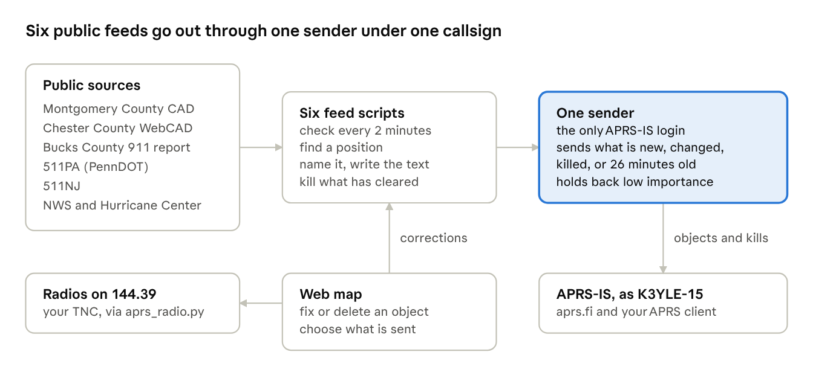
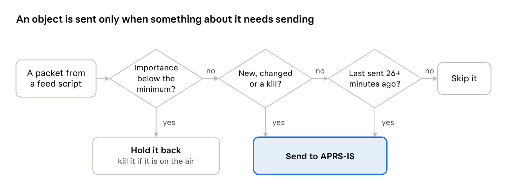
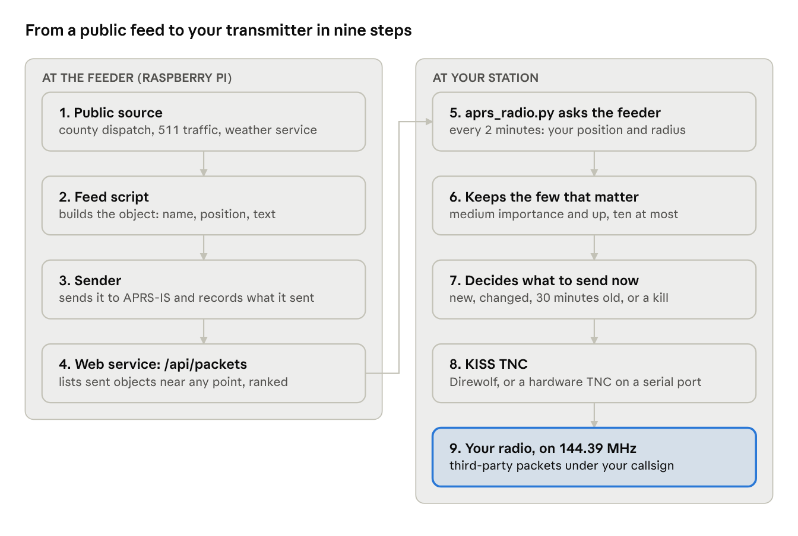

# The APRS Incident Feeder: local fires, crashes and storms on your APRS map

By K3YLE · November 2026

The Incident Feeder is a Raspberry Pi service that turns public dispatch, traffic and weather feeds for our area into APRS objects, sent to APRS-IS under the callsign K3YLE-15.

## What it does

Open aprs.fi or any APRS client around Montgomery, Chester and Bucks counties and you will see more than stations. A fire-truck symbol marks a building fire, a crash symbol marks an accident on the Blue Route, and a tornado symbol follows a warned storm across the map.

Each one is an APRS object with a short name, a position, a symbol and a line of text. The feeder checks its sources every two minutes. When an incident appears, it creates an object. When the incident changes, it updates the object. When the incident clears, it sends a kill packet so the object leaves your map instead of lingering.

On a typical afternoon it carries about 180 objects.

You can also watch them without an APRS client, on the feeder's own read-only map at [aprs-incidents.phlm.sh](https://aprs-incidents.phlm.sh).

## How it works



Each source has its own small script. None of them talks to APRS-IS. They hand their packets to a single sender, which holds the one connection and decides what actually goes out. Everything is plain Python on a Raspberry Pi.

## Where the data comes from

All seven sources are public. The newest, the river and tide gauges, appears only while a gauge is flooding or at low water. Two give no coordinates, so the feeder looks up the cross streets and marks an approximate position with a trailing question mark.

| Source | What it gives | Position |
| --- | --- | --- |
| [Montgomery County live CAD](https://webapp07.montcopa.org/eoc/cadinfo/livecad.asp) | Fire and traffic dispatches | Looked up from cross streets |
| [Chester County WebCAD](https://webcad.chesco.org/WebCad/webcad.asp) | Fire and traffic dispatches | Looked up from cross streets |
| [Bucks County 911 Incident Report](https://www.buckscounty.gov/2150/911-Incident-Report) | Fire and traffic dispatches | Supplied |
| [511PA](https://www.511pa.com/) (PennDOT) | Crashes, closures, roadwork | Supplied |
| [511NJ](https://511nj.org/) | Crashes, closures, delays | Supplied |
| [National Weather Service](https://www.weather.gov/) and National Hurricane Center | Warnings, watches, tracked storms | Storm fix or warned area |
| NWS river and tide gauges | Flooding and low water | Supplied |

## Example objects

The first packet below is a real one from the feeder's log. The other two show the usual form of a weather object and a kill.

```
K3YLE-15>APRS,TCPIP*:;TRAFD81BU*241700z4014.24N\07528.65W'VEHICLE ACCIDENT TOWNSHIP LINE RD/BRIDGE ST (PERKIOMEN) @12:00
K3YLE-15>APRS,TCPIP*:;WNDPHI012*241530z4000.60N\07500.90WgHIGH WIND WRN til Fri
K3YLE-15>APRS,TCPIP*:;FIRE9HH4F_241837z4001.22N/07518.25Wf
```

Reading the first one left to right:

- **`TRAFD81BU`** is the object's name: a tag for the kind of incident, then a short code that stays the same for its whole life. Fires start with `FIRE`, roadwork with `WORK`, and weather with the alert type and forecast office.
- **`*`** means the object is live. The third packet has **`_`** there instead, which kills it.
- **`241700z`** is the day and time in UTC.
- **`4014.24N\07528.65W'`** is the position, with the crash-site symbol.
- The rest is the call type, the cross streets, the township and the dispatch time.

## What gets sent, and when



An unchanged object is repeated every 26 minutes, which keeps it alive on maps without filling APRS-IS with copies. Before this, every script re-sent everything every two minutes.

Every object is also rated for importance, and the operator can set the lowest level that is sent:

- **Critical:** tornado warning, entrapment, explosion, hazmat.
- **High:** building fire, rescue, a crash that closes the road, severe storm warning.
- **Medium:** other fires, crashes, road closures, other weather warnings.
- **Low:** alarms, disabled vehicles, roadwork, weather watches.

The sender also acts on its own in three cases. If a source stops answering, its objects are taken off after two hours, so nothing stale lingers. When a county dispatch feed and a 511 feed report the same crash, only the more important object is sent. And anything rated critical also goes out as an APRS bulletin (BLN1 to BLN3), so radios that show messages but no map still get it.

## Getting it on the air

The objects reach APRS-IS, so an internet-connected client shows them today. Putting them on 144.39 MHz takes a station in the area, and there is now a script for that.

`aprs_radio.py` runs beside your radio. Every two minutes it asks the feeder for the objects within a chosen distance of you, most important first, and sends the ones that are new or changed to your KISS TNC. That can be Direwolf or another software TNC, or a hardware TNC on a serial port. It needs only Python.



Steps 1 to 4 happen at the feeder whether or not anyone is listening. Steps 5 to 9 run at your station, and only when you start the script.

```
python3 aprs_radio.py --callsign W3XYZ-10 --lat 40.00 --lon -75.00
```

Run like this, it only prints what it would send, so you can watch it before keying up. Add `--transmit` when the list looks right. Packets go out under your own callsign in APRS third-party form, which keeps igates from sending them back to the internet a second time.

The script is deliberately selective. Within one 25 mile radius there are about 130 objects, far too many for a shared 1200 baud channel. It starts with a 10 mile radius, medium importance and above, and at most ten objects on the air at once.

The command above uses the defaults: it asks this feeder and talks to Direwolf on the same machine. `--server` names another feeder, `--kiss-tcp` another TNC address, and `--kiss-serial` a hardware TNC on a serial port. The script has keyed a real radio through Direwolf: two objects and their kills went out on 144.39. A second station confirming the decode is the next step. It also transmits the bulletins for critical objects in your area, ahead of the objects.

Adding `--auto` makes the script carry everything in your radius, a little at a time. It sends only two or three packets per poll from a queue: kills first, then bulletins, then objects by importance. A new fire jumps ahead of roadwork, and the low-importance objects go out only when nothing more important is waiting.

## Running it all the time

The script lives in the `aprs-incident-rf-bridge` folder of the project's repository, [github.com/kyleyankan/prm-aprs-utils](https://github.com/kyleyankan/prm-aprs-utils/tree/main/aprs-incident-rf-bridge). On a Linux machine beside the radio, a Raspberry Pi for example, one command installs it as a service that starts at boot:

```
sudo sh systemd/install.sh
```

The installer asks three things: your callsign, the position at the centre of your area, and a radius. It leaves transmitting off. You read its log until the list looks right, then set `transmit = yes`. The folder's install guide covers the settings, the day-to-day commands and how to take your objects off the air when you stop.

If you run an igate or digipeater and would like to carry local incidents for your area, that is all it takes, and K3YLE would like to hear how it goes.

## See it and read more

- **The live map** is at [aprs-incidents.phlm.sh](https://aprs-incidents.phlm.sh). It shows what is being sent right now, and you can hide the sources and importance levels you do not want to see.
- **The documentation** is linked from that map, at [aprs-incidents.phlm.sh/docs](https://aprs-incidents.phlm.sh/docs): where the data comes from, how it is processed, and how to deploy it with your radio.
- **On any APRS map**, look for **K3YLE-15** on [aprs.fi](https://aprs.fi/info/a/K3YLE-15).
