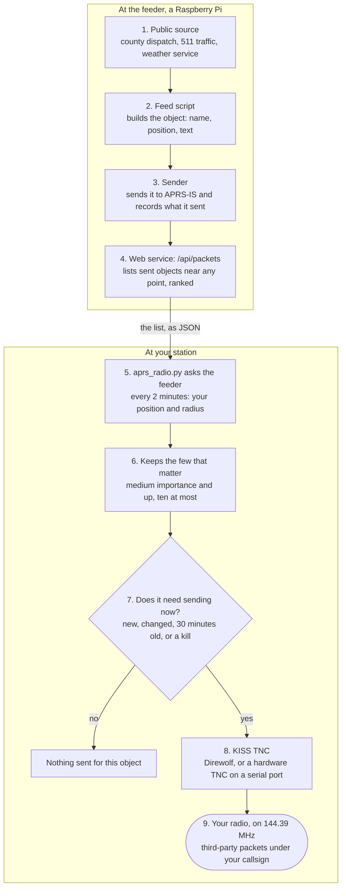

# aprs-radio: put the Incident Feeder's objects on the air

`aprs_radio.py` is for a licensed operator with a radio and a KISS TNC. It asks an Incident Feeder
for the objects near you, picks the ones worth sending, and transmits them through your TNC under
your callsign. It needs only Python 3.8 or later; there is nothing to install.

## From the feed source to your radio



Steps 1 to 4 happen at the feeder whether or not anyone is listening. Steps 5 to 9 run at your
station, and only when you start the script. Without `--transmit`, step 8 prints the packet
instead of sending it.

## Before you start

- **A licence that covers what you transmit.** Your station sends these packets, so you are its
  control operator.
- **A KISS TNC.** A software TNC such as Direwolf with its KISS TCP port on (the default, 8001), or
  a hardware TNC in KISS mode on a serial port.
- **The feeder's address.** K3YLE's feeder is at `https://aprs-incidents.phlm.sh`. Another feeder's operator will give you
  theirs.
- **Your position** as a latitude and longitude, and a radius in miles.

What the feeder's operator sees: each request carries your callsign, the position and radius you
ask for, and your internet address. The feeder keeps those for 7 days and shows them on its
operator's map.

## Try it without transmitting

Without `--transmit` the script only prints what it would send. Start here:

```sh
python3 aprs_radio.py --server https://aprs-incidents.phlm.sh --callsign W3XYZ-10 --lat 40.12 --lon -75.34 --once
```

Each line shows the reason (`new`, `changed`, `refresh`, `kill` or `dropped`) and the packet.

## Transmit

Add `--transmit` once the list looks right.

```sh
# Direwolf or another software TNC on this machine
python3 aprs_radio.py --server https://aprs-incidents.phlm.sh --callsign W3XYZ-10 --lat 40.12 --lon -75.34 --transmit

# a hardware TNC in KISS mode (Linux or macOS)
python3 aprs_radio.py --server https://aprs-incidents.phlm.sh --callsign W3XYZ-10 --lat 40.12 --lon -75.34 \
    --kiss-serial /dev/ttyUSB0 --baud 9600 --transmit
```

On Windows, use a software TNC and `--kiss-tcp`; the serial option needs Linux or macOS.

## What it sends, and how often

| Situation | What happens |
|---|---|
| An object is new, or its position, symbol or text changed | Transmitted |
| An object is unchanged | Transmitted again every 30 minutes (`--refresh`) |
| The feeder kills an object you transmitted | The kill is transmitted |
| An object you transmitted leaves the list | Your station kills it, so it does not linger on maps |
| The feeder cannot be reached | Nothing is transmitted and nothing is killed |
| The TNC cannot be reached | Reported, and tried again on the next poll |

The defaults are deliberately small, because a shared 1200 baud channel fills quickly:

| Option | Default | Meaning |
|---|---|---|
| `--miles` | 10 | radius around your position |
| `--min` | medium | least important level to carry: `low`, `medium`, `high` or `critical` |
| `--max-objects` | 10 | most objects kept on the air at once, most important first |
| `--max-per-poll` | 6 | most packets transmitted per poll |
| `--gap` | 8 | seconds between two transmissions (never less than 2) |
| `--poll` | 120 | seconds between polls of the feeder (never less than 60) |
| `--refresh` | 30 | minutes before an unchanged object is sent again (never less than 10) |
| `--path` | none | digipeater path, such as `WIDE2-1` |

With `--min low` the list fills with roadwork. Leave it at `medium` or higher unless your area is
quiet.

## How the packets look on the air

They go out in APRS third-party form, from your callsign:

```
W3XYZ-10>APZIFD:}K3YLE-15>APRS,TCPIP,W3XYZ-10*:;FIRE7K2QX*241740z4007.80N/07519.80WdBUILDING FIRE MAIN ST/OAK ST
```

- **Your callsign is the sender**, so the transmission is identified as yours.
- **The feeder stays the owner of the object.** If you sent the bare object instead, your station
  would take the object over, and any igate that heard it would put a second copy on APRS-IS.
  Igates do not pass third-party packets back.
- **`APZIFD`** is an experimental destination; `--tocall` changes it.

## Running it all the time

What was transmitted is kept in `aprs_radio_state.json` (`--state-file`), so stopping and starting
does not send everything again. To run it at boot on a Linux machine, a systemd unit along these
lines works:

```ini
[Unit]
Description=Incident Feeder RF gateway
After=network-online.target

[Service]
WorkingDirectory=/home/pi/aprs-radio
ExecStart=/usr/bin/python3 aprs_radio.py --server https://aprs-incidents.phlm.sh --callsign W3XYZ-10 --lat 40.12 --lon -75.34 --transmit
Restart=on-failure

[Install]
WantedBy=multi-user.target
```

If you stop it for good while objects are on the air, they are not killed; they fade from maps as
clients time them out.

## Tests

```sh
cd tests && python3 -m unittest test_radio
```

The tests use a fake feeder and a fake TNC on this machine and never key a radio.
